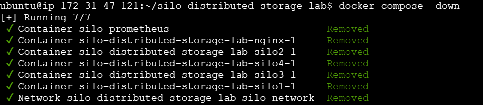
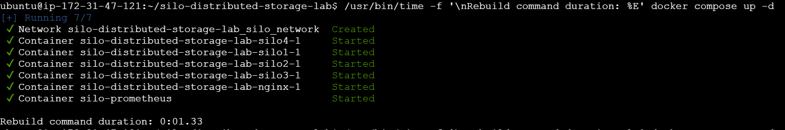
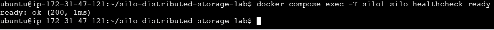

# Phase 08: Rebuild from Scratch

## 1. Overview

This phase validates the rebuilding of the Silo Distributed Object Storage Lab using Docker Compose.

The objective was to remove the existing containers and network, recreate the services, record the rebuild command duration, and verify service health and Silo readiness.

**Final Result: PASS**

All four Silo nodes reported a healthy status. Nginx and Prometheus were running, and the Silo readiness check succeeded.

## 2. Environment

| Component               | Details                            |
| ----------------------- | ---------------------------------- |
| Container orchestration | Docker Compose                     |
| Object storage          | Silo                               |
| Storage nodes           | `silo1`, `silo2`, `silo3`, `silo4` |
| Reverse proxy           | Nginx                              |
| Monitoring              | Prometheus                         |
| Storage persistence     | Host bind-mounted directories      |

## 3. Step 1: Stop the Existing Lab

### Command

```bash
docker compose down
```

### Purpose

This command stopped and removed the existing Docker Compose containers and network.

The following services were removed:

* Four Silo containers
* Nginx container
* Prometheus container
* Docker Compose network

The existing host storage directories were preserved.

### Screenshot 1: Lab Shutdown

**Screenshot location:** `docs/08-rebuild/screenshots/01-destroy-lab.png`



## 4. Step 2: Rebuild the Lab

### Command

```bash
/usr/bin/time -f '\nRebuild command duration: %E' docker compose up -d
```

### Recorded Output

```text
Rebuild command duration: 0:01.33
```

### Result

The Docker Compose startup command completed in **1.33 seconds**.

This measurement represents the execution time of `docker compose up -d`. It does not represent the total time required for every service to become healthy.

### Screenshot 2: Rebuild Command and Timing

**Screenshot location:** `docs/08-rebuild/screenshots/02-rebuild-time.png`



## 5. Step 3: Verify Container Status

### Command

```bash
docker compose ps
```

### Observed Results

| Service    | Status  |
| ---------- | ------- |
| `silo1`    | Healthy |
| `silo2`    | Healthy |
| `silo3`    | Healthy |
| `silo4`    | Healthy |
| Nginx      | Running |
| Prometheus | Running |

### Result

All four Silo nodes were healthy. Nginx and Prometheus were also running.

## 6. Step 4: Verify Silo Readiness

### Command

```bash
docker compose exec -T silo1 silo healthcheck ready
```

### Output

```text
ready: ok (200, 1ms)
```

### Result: PASS

The readiness check against Silo Node 1 succeeded with HTTP status `200`.

The reported `1ms` represents the health check duration, not the total cluster startup time.

### Screenshot 3: Health and Readiness Verification

**Screenshot location:** `docs/08-rebuild/screenshots/03-health-verification.png`



## 7. Rebuild Results Summary

| Verification                            | Result       |
| --------------------------------------- | ------------ |
| Existing containers and network removed | PASS         |
| Docker Compose services recreated       | PASS         |
| Rebuild command duration recorded       | 1.33 seconds |
| Four Silo nodes healthy                 | PASS         |
| Nginx running                           | PASS         |
| Prometheus running                      | PASS         |
| Silo Node 1 readiness check             | PASS         |

## 8. Data Persistence and Test Scope

The lab uses host bind-mounted directories for Silo storage:

* `data/silo1`
* `data/silo2`
* `data/silo3`
* `data/silo4`

These directories were intentionally preserved during this phase.

Therefore, this test validates a **container-level rebuild with existing storage data preserved**, rather than a complete rebuild using empty storage directories.

## 9. Limitations

* The recorded 1.33 seconds measures the execution time of the Docker Compose startup command only.
* The complete elapsed time until all services became healthy was not measured.
* The readiness check was executed against `silo1`, not individually against all four nodes.
* Existing Silo storage directories were preserved.
* The reported service states reflect the verification performed after the rebuild.

## 10. Evidence Files

```text
docs/08-rebuild/
├── README.md
├── evidence/
│   └── rebuild-results.txt
└── screenshots/
    ├── 01-destroy-lab.png
    ├── 02-rebuild-time.png
    └── 03-health-verification.png
```

The `evidence/rebuild-results.txt` file contains the rebuild procedure, recorded command duration, service status results, readiness output, and test limitations.

## 11. Conclusion

The Silo Distributed Object Storage Lab was successfully rebuilt using Docker Compose. All four Silo nodes reported healthy status, Nginx and Prometheus were running, and the readiness check against Silo Node 1 succeeded.

The measured startup command duration was **1.33 seconds**. This result represents the Docker Compose command execution time, not the total time required for the complete cluster to become healthy.

The phase demonstrates successful container reconstruction while preserving the existing storage data and configuration.

